# Introduction to MetaNB

## 1 Introduction

This vignette provides a step-by-step introduction to the MetaNB
package, which implements a trivariate random-effects meta-analysis of
prevalence, sensitivity, and specificity, to indirectly meta-analyze Net
Benefit, along with associated value-of-information (VOI) metrics for
quantifying decision uncertainty. The trivariate random-effects
meta-analysis is described in detail in ([Wynants et al.
2018](#ref-wynants_random-effects_2018)), and the associated VOI
framework is described in \[ref placeholder\].

This vignette demonstrates a typical workflow: importing study-level
data, fitting a trivariate meta-analysis model, assessing convergence,
summarizing posterior draws, visualizing results with forest plots, and
obtaining VOI metrics when decision uncertainty is of interest.

The main input is a data frame with one row per validation setting.
Depending on the application, a validation setting may correspond to a
study, center, hospital, registry, or other independently evaluated
dataset. At minimum, the model-fitting function requires columns for the
number of true positives, true negatives, events, and non-events.
Additional columns such as study label, country, and reported point
estimates and confidence intervals, can be included and later used for
forest plots.

The central function is
[`MA_NB_tri()`](https://zhipeiwang.github.io/MetaNB/reference/MA_NB_tri.md).
It fits the Bayesian trivariate random-effects model and returns
posterior MCMC samples, together with metadata about the model fitting
process and prior settings. Downstream functions then work from those
posterior samples. For example,
[`summarize_tri_ma()`](https://zhipeiwang.github.io/MetaNB/reference/summarize_tri_ma.md)
summarizes selected posteriors, and
[`plot_forest()`](https://zhipeiwang.github.io/MetaNB/reference/plot_forest.md)
visualizes study-specific, pooled, and predictive results.

When `compute_EVPI = TRUE` and other related arguments are supplied,
[`MA_NB_tri()`](https://zhipeiwang.github.io/MetaNB/reference/MA_NB_tri.md)
also monitors the additional quantities needed for VOI analysis and
returns VOI metrics in the same fitted object. This allows the
meta-analysis summaries, forest plots, and VOI metrics to be based on
the same MCMC run.

## 2 Example data

The IOTA-ADNEX is a regression model that distinguishes between benign
and several types of malignant adnexal masses ([Van Calster et al.
2014](#ref-van_calster_evaluating_2014)). The dataset used in this
vignette is from a systematic review of external validation studies of
ADNEX ([Barreñada et al. 2024](#ref-barrenada_adnex_2024)), in which
sensitivity and specificity were meta-analyzed at the commonly used 10%
risk of malignancy threshold.

For illustration purposes, we restrict the dataset to studies in which
ADNEX was used with CA125, and refer to this subset as
`data_ADNEXCA125`. The dataset is available in the MetaNB package, and
is loaded automatically with
[`library(MetaNB)`](https://zhipeiwang.github.io/MetaNB/). It contains
the numbers of true positives and true negatives, numbers of events and
non-events, reported sensitivity and specificity with corresponding
confidence intervals, as well as characteristics of each validation
setting such as publication, country, sample size, and prevalence. In
this example dataset, rows correspond to validation centers rather than
studies, so studies containing multiple centers may contribute more than
one row.

``` r

knitr::kable(head(data_ADNEXCA125))
```

| Publication | Country | N | Prev | n_nonevent | n_event | TP | TN | sens_point | sens_ci_low | sens_ci_high | spec_point | spec_ci_low | spec_ci_high |
|:---|:---|---:|---:|---:|---:|---:|---:|---:|---:|---:|---:|---:|---:|
| Araujo (2017) | Brazil | 131 | 0.5190840 | 63 | 68 | 63.9880 | 34.9650 | 0.9410 | NA | NA | 0.5550 | NA | NA |
| Chen (2022) | Taiwan | 281 | 0.2064057 | 221 | 58 | 53.0120 | 175.9470 | 0.9140 | 0.8420 | 0.9860 | 0.7890 | 0.7360 | 0.8430 |
| Diaz (2017) | Venezuela | 227 | 0.2995595 | 159 | 68 | 62.9952 | 132.9876 | 0.9264 | NA | NA | 0.8364 | NA | NA |
| He (2022) | China | 620 | 0.3516129 | 402 | 218 | 191.9708 | 378.2820 | 0.8806 | 0.8358 | 0.9254 | 0.9410 | 0.9179 | 0.9641 |
| Jeong (2020) | South Korea | 54 | 0.1851852 | 44 | 10 | 9.0000 | 34.9800 | 0.9000 | NA | NA | 0.7950 | NA | NA |
| Joyeux (2016) | France | 284 | 0.1056338 | 254 | 30 | 27.0000 | 205.9940 | 0.9000 | NA | NA | 0.8110 | NA | NA |

Throughout this vignette, we use `data_ADNEXCA125` as a running example
to illustrate the package functionality.

## 3 Fit the trivariate random-effects meta-analysis

### 3.1 Basic fit without VOI

``` r

# download the package from GitHub
remotes::install_github("zhipeiwang/MetaNB")

# load the package
library(MetaNB)

# load other packages
library(dplyr)
library(coda)
```

[`MA_NB_tri()`](https://zhipeiwang.github.io/MetaNB/reference/MA_NB_tri.md)
fits the Bayesian trivariate random-effects model for prevalence,
sensitivity, and specificity described in ([Wynants et al.
2018](#ref-wynants_random-effects_2018)). It takes the number of true
positives (`tp`), true negatives (`tn`), the number of events
(`n_event`) and the number of non-events (`n_nonevent`) as input. A
threshold (`t`) for which true positives and true negatives are defined
is also needed to compute the net benefit and related metrics.

By default, the model is fitted using weak realistic priors
(`prior_type = "weak"`) under the product-normal parameterization using
priors specified in ([Wynants et al.
2018](#ref-wynants_random-effects_2018)). For most applications, the
default prior settings can safely be used and do not require adjustment.
The section on “Weak realistic priors (advanced options)” below provides
more details on the implementation of the weak realistic priors and how
to modify them if needed. It is generally recommended to compare results
with different prior specifications to assess sensitivity to the choice
of prior.

The argument `return_vars` controls which parameters are returned. By
default, net benefit related quantities and the posterior probability of
clinical usefulness are returned. Additional quantities can be requested
if needed (see ?MA_NB_tri for details).

The argument `seed` can be set for reproducibility so we get the same
results when we run the same code multiple times and when others run the
same code. This `seed` argument sets the RNG seed for each JAGS chain,
and the argument `rng_name` can be used to specify the type of random
number generator (RNG) used in JAGS. By default, we use the
“base::Wichmann-Hill” RNG, which is a commonly used RNG in JAGS.

``` r

# basic fit without VOI
MA_NB_tri(data = data_ADNEXCA125, # data frame containing the data
          tp = TP, tn = TN, n_event = n_event, n_nonevent = n_nonevent, # column names in the data frame for the input data
          prior_type = "weak", # type of prior to use, either "weak" or "wishart"
          t = 0.1, # threshold for defining true positives and true negatives
          return_vars = c("NB", "RU", "probuseful", "sens", "spec"), # we additionally request relative utility (RU), sensitivity (sens), and specificity (spec) because these quantities will be used later in the vignette
          seed = 123, # random seed for reproducibility
          prev_known = 0.5, # this is to calculate conditional estimates of net benefit assuming a known prevalence
          return_known = TRUE # return the conditional estimates of net benefit assuming a known prevalence
          )
```

### 3.2 Fit with VOI enabled

To obtain value-of-information (VOI) metrics such as the expected value
of perfect information (EVPI), we can run the following code with the
same function, but with some additional arguments to enable the VOI
calculations. We will elaborate more on this when we discuss the VOI
analysis in more detail later in the vignette. For now, the main point
is that we can obtain VOI metrics as part of the same model fitting
process, without needing to run a separate function or workflow, and we
should use the same fitted object throughout once we’ve decided to
include the calculation of VOI metrics, because the VOI metrics are
ideally based on the same MCMC sampling process and same posterior
samples as the other quantities of interest.

``` r

# fit with VOI enabled

fit_voi <- MA_NB_tri(data = data_ADNEXCA125,
                     tp = TP, tn = TN, n_event = n_event, n_nonevent = n_nonevent,
                     prior_type = "weak",
                     t = 0.1,
                     return_vars = c("NB", "RU", "probuseful", "sens", "spec", "pooledprev"),
                     seed = 123,
                     prev_known = 0.5,
                     return_known = TRUE,
                     
                     # VOI specific arguments
                     compute_EVPI = TRUE, # enable the computation of VOI quantities
                     auto_resample = FALSE, # whether to automatically draw additional samples until diagnostics indicate that the EVPI estimates are stable
                     center_rows = 1:36, # which rows (centers) to calculate the center-specific EVPI calculation
                     center_label_cols = c("Publication", "Country") # which columns to use for labeling the centers in the output of center-specific EVPI
                     )
```

    Including estimates/predictions at assumed know prevalence: prev_known = 0.5

    Computing center-specific EVPI for rows: 1, 2, 3, 4, 5, 6, 7, 8, 9, 10, 11, 12, 13, 14, 15, 16, 17, 18, 19, 20, 21, 22, 23, 24, 25, 26, 27, 28, 29, 30, 31, 32, 33, 34, 35, 36

``` output
Compiling model graph
   Resolving undeclared variables
   Allocating nodes
Graph information:
   Observed stochastic nodes: 108
   Unobserved stochastic nodes: 3122
   Total graph size: 27220

Initializing model
```

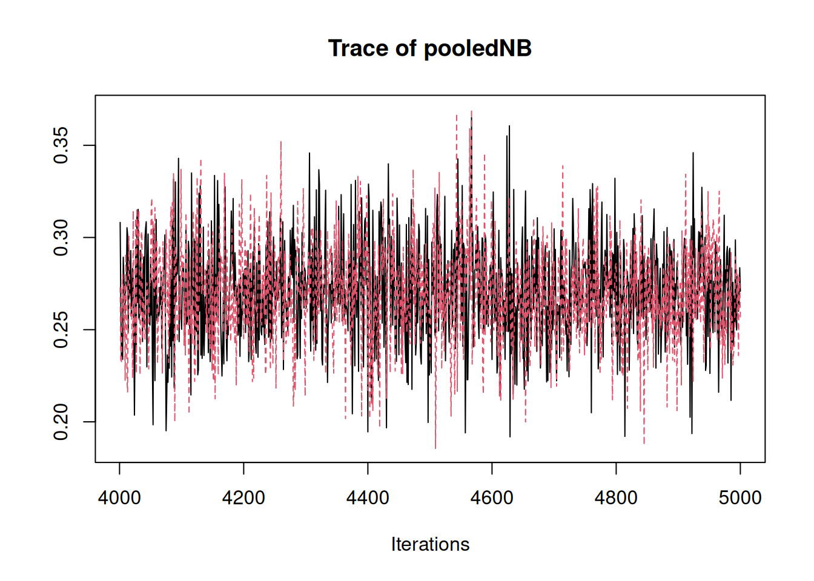


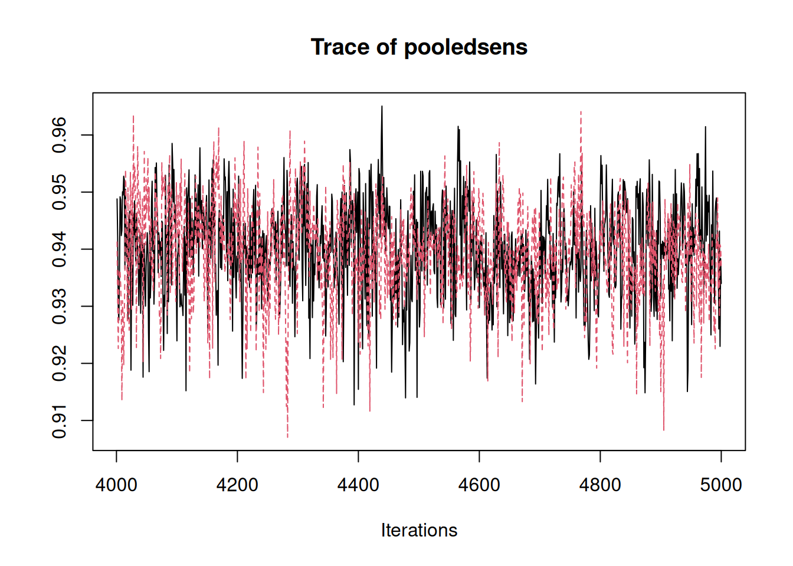

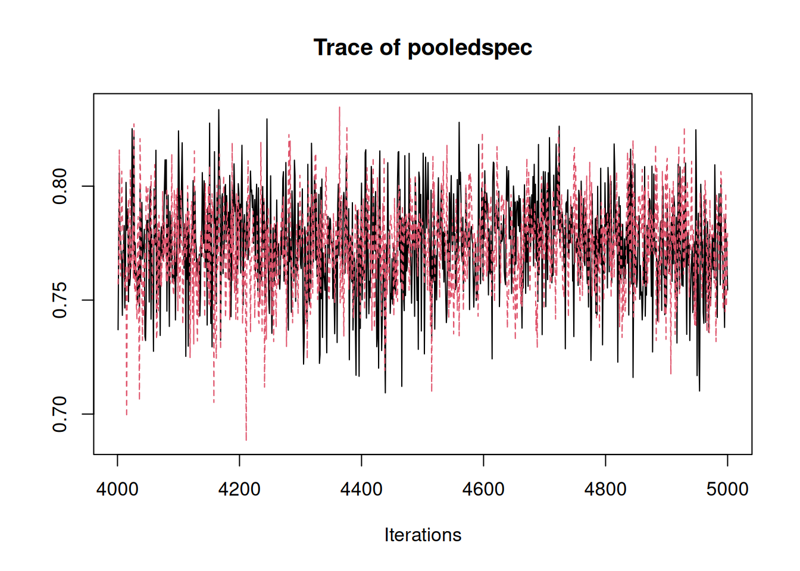

#### 3.2.1 Weak realistic priors (advanced options)

Here we briefly describes how the weak realistic priors are implemented
in MetaNB. This is mainly relevant if we wish to modify hyperparameters
or conduct prior sensitivity analyses. More details can be seen in
Wynants et al. ([2018](#ref-wynants_random-effects_2018)).

In our implementation, the logit prevalence is controlled by `etap`, the
summary logit prevalence. The logit sensitivity and specificity are
defined through relationships that depend on prevalence:

- `etap` is the summary logit prevalence (prior:
  `etap ~ dnorm(mu_etap, tau_etap)`).

- `lambdasens0` and `lambdasens1` define the summary logit sensitivity
  (`mean.sens`) as `lambdasens0 + lambdasens1 * etap`.

- `lambdaspec0`, `lambdaspec1`, and `lambdaspec2` define the summary
  logit specificity as
  `lambdaspec0 + lambdaspec1 * etap + lambdaspec2 * mean.sens`.

Between-study heterogeneity is represented through variance parameters
for prevalence, sensitivity, and specificity (`varprev`, `varsens`,
`varspec`), with half-normal priors. Correlations among the three
outcomes are represented by `corr.sens.spec`, `corr.spec.prev`, and
`corr.sens.prev`. In our specification, two correlations (correlations
between logit sensitivity and logit specificity, and between logit
specificity and logit prevalence) use Fisher-z normal priors (`zss`,
`zsp`) and one correlation uses a uniform prior
(`corr.sens.prev ~ dunif(a_csp, b_csp)`). Visualizations of those priors
can be found in Figure A1, the Appendix from Wynants et al.
([2018](#ref-wynants_random-effects_2018)).

Users interested in the full model specification can inspect the JAGS
code in `model_text_weak.R` in the GitHub repository.

We can override any subset of these hyperparameters using
`weak_priors = list(...)`. Any values not supplied remain at their
defaults, which makes it straightforward to run prior sensitivity
analyses.

For example, to change only the prior mean for `etap` (the summary logit
prevalence), we can supply:

``` r

MA_NB_tri(data = data_ADNEXCA125,
          tp = TP, tn = TN, n_event = n_event, n_nonevent = n_nonevent,
          prior_type = "weak",
          t = 0.1,
          return_vars = c("NB", "RU", "probuseful", "sens", "spec"),
          seed = 123,
          weak_priors = list(mu_etap = -0.9) # example of overriding the prior mean for etap
          )
```

#### 3.2.2 Get details on model fitting

To get details on the settings and priors used in the model fitting, we
can check the following elements of the fitted object, which contain the
meta-information about the model fitting process. For example, we can
get details on the prior used and hyperparameters used for prior
specification by running the following code, where the first line of
code tells us which type of prior is used, and the second line of code
gives us the specific hyperparameter values for the priors that are used
in the model fitting process. This is particularly useful when we run
multiple models with different priors and want to keep track of which
model uses which priors, or when we want to report the details of the
priors used in our analysis for transparency and reproducibility.

``` r

fit_voi$meta$prior_type
fit_voi$priors_used
```

``` output
[1] "weak"
```

``` output
# A tibble: 15 × 2
   prior           value
   <chr>           <chr>
 1 mu_etap         0
 2 tau_etap        0.001
 3 mu_lambdasens0  0
 4 tau_lambdasens0 0.001
 5 mu_lambdaspec0  0
 6 tau_lambdaspec0 0.001
 7 mu_zss          -0.2
 8 tau_zss         4
 9 mu_zsp          -0.2
10 tau_zsp         4
11 a_csp           -0.99
12 b_csp           0.99
13 tau_varprev     0.25
14 tau_varsens     0.25
15 tau_varspec     0.25 
```

Other meta-information about the model fitting process, such as MCMC
settings, can also be found in the `meta` element of the fitted object.
For example, we can check the MCMC settings used for the model fitting
by running `fit_voi$meta`.

``` r

fit_voi$meta
```

``` output
$t
[1] 0.1

$prev_known
[1] 0.5

$prior_type
[1] "weak"

$returned
 [1] "NB"                "pooledNB"          "pooledNB_TA"
 [4] "NBnew"             "NBnew_TA"          "pooledNB_known"
 [7] "pooledNB_TA_known" "NBnew_known"       "NBnew_TA_known"
[10] "RU"                "pooledRU"          "RUnew"
[13] "pooledRU_known"    "RUnew_known"       "probuseful"
[16] "probuseful_known"  "sens"              "pooledsens"
[19] "sensnew"           "spec"              "pooledspec"
[22] "specnew"           "pooledprev"        "ENBnew"
[25] "ENBnew_TA"         "prevnew"           "NB_TA"

$n.chains
[1] 2

$n.adapt
[1] 1000

$burnin
[1] 3000

$iter
[1] 1000

$thin
[1] 1

$saved_per_chain
[1] 1000

$total_saved
[1] 2000

$seed
[1] 123

$RNG_name_per_chain
[1] "base::Wichmann-Hill" "base::Wichmann-Hill"

$RNG_seed_per_chain
[1] 123 124

$rounds
[1] 1

$stop_reason
[1] "auto_resample=FALSE"
```

## 4 Convergence assessment

We can control the MCMC settings through arguments such as the number of
chains(`n.chains`), adaptation iterations (`n.adapt`), burn-in
(`burnin`), sampling iterations (`iter`), and thinning(`thin`). By
default, the function runs 2 chains with 1000 iterations each,
adaptation iterations of 1000, a burn-in of 3000 and a thinning of 1.
After adaptation and burn-in, trace plots of a set of pooled quantities
(for example `pooledsens`, `pooledspec`, `pooledNB`, `pooledNB_TA`, and
`pooledRU`) are shown by default as a rough check. The set of nodes used
for these trace plots can be adjusted via `diag_vars`, or turned off by
setting `diag_vars = NULL`.

After fitting the model and obtaining the posterior samples, we can
perform a formal convergence check using the returned MCMC output.

The fitted object contains the posterior samples as a
[`coda::mcmc.list`](https://rdrr.io/pkg/coda/man/mcmc.list.html) object.
We can use the
[`traceplot()`](https://rdrr.io/pkg/coda/man/traceplot.html) function
from the `coda` package to visualize the MCMC chains for selected
parameters. The parameters must be included via the `return_vars`
argument when fitting the model. For example, to check the trace plots
for the pooled sensitivity, pooled prevalence, pooled specificity,
pooled net benefit, pooled net benefit for the treat all strategy, and
pooled relative utility, we can run:

``` r

traceplot(fit_voi$samples[, c("pooledsens", "pooledspec", "pooledNB", "pooledNB_TA", "pooledRU")])
```

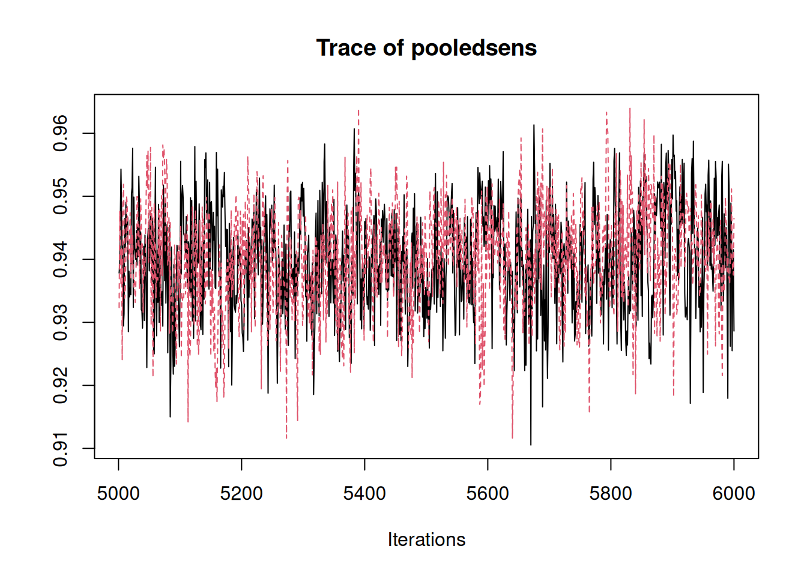

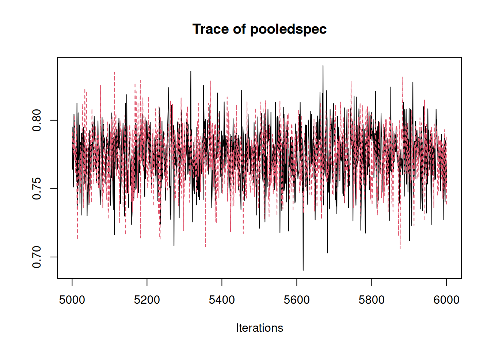

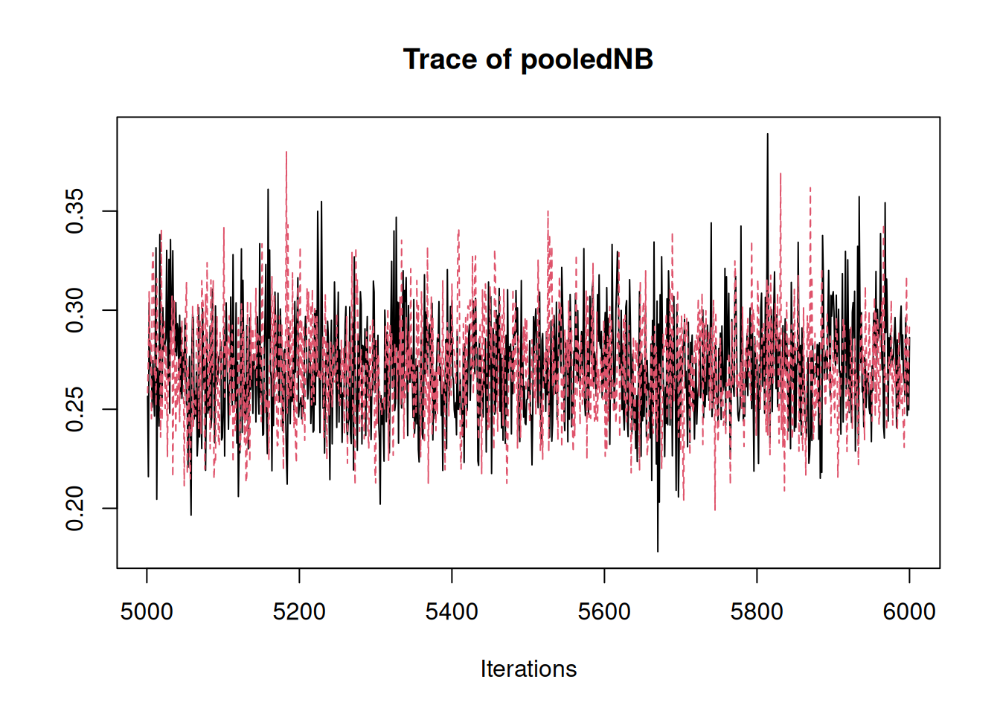

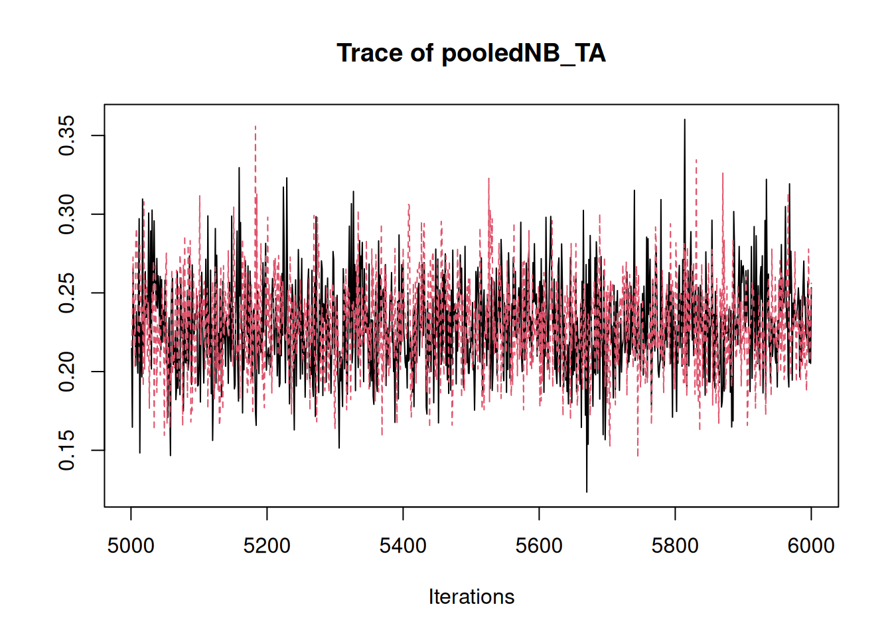

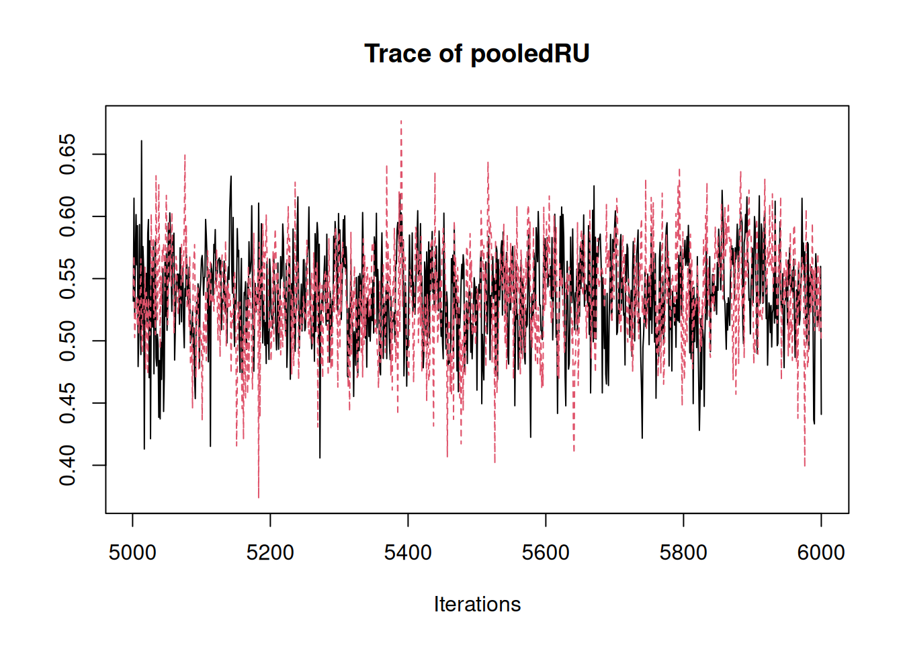

By default, we run two chains. When examining a trace plot, we look for
the following:

- The chains fluctuate around a stable level without obvious trends.

- The chains overlap substantially and explore the same range of values.

- There are no long periods where one chain stays in a very different
  range than the other.

If the chains appear to mix well and fluctuate in a similar range, we
typically consider convergence to be adequate. If the chains remain
separated or show strong trends, this indicates they fail to converge,
and we may consider increasing the number of iterations or burn-in.

## 5 Summarize posterior draws

After checking that the chains have mixed well for key parameters, we
summarize the posterior distributions of the quantities we care about.
The function
[`summarize_tri_ma()`](https://zhipeiwang.github.io/MetaNB/reference/summarize_tri_ma.md)
provides a convenient summary of the fitted trivariate meta-analysis. We
pass the `fit` or `fit$samples` to the function, and specify the metrics
we want to summarize using the `metrics`. By default, `metrics` include
`NB` and the quantity `probuseful`. Note, summaries can only be computed
for quantities that were sampled and returned by the model fitting
function. In practice, this means that the relevant quantities must have
been included in `return_vars` when fitting the model.

In MetaNB, some summary targets are families of related quantities,
while others are single nodes from the model. Family metrics such as
`NB`, `RU`, `sens`, and `spec` include pooled summaries, predictive
summaries for a new setting, and optionally per-study summaries. For
`NB`, its family of summary targets also extend to the net benefit of
the default strategies treat-all and treat-none. In contrast, quantities
such as `pooledprev` correspond to a single model node and therefore
return only a single posterior summary (mean, median, and 95% credible
interval), without predictive or per-study summaries.

To summarize the main pooled and predictive quantities, we can run:

``` r

summarize_tri_ma(
  fit_voi$samples,
  data = data_ADNEXCA125,
  label_cols = c("Publication", "Country", "N", "Prev"),
  metrics = c("NB", "RU", "probuseful", "sens", "spec"),
  per_study_metrics = c("NB", "RU", "sens", "spec"),
  return_known = FALSE, # asks to not return summaries for conditional estimates of net benefit assuming a known prevalence
  include_per_study = FALSE) # asks to not return per-study estimates
```

``` output
$NB
$NB$pooled
$NB$pooled$model
     Mean    Median       Low      High
0.2708381 0.2699689 0.2221622 0.3281561

$NB$pooled$treat_all
     Mean    Median       Low      High
0.2294501 0.2283099 0.1745434 0.2940323


$NB$predictive
$NB$predictive$model
      Mean     Median        Low       High
0.28465248 0.26492738 0.06673823 0.62296327

$NB$predictive$treat_all
        Mean       Median          Low         High
 0.246344611  0.227925356 -0.005546463  0.620081486


$RU
$RU$pooled
$RU$pooled$model
     Mean    Median       Low      High
0.5362127 0.5370949 0.4581012 0.6075756


$RU$predictive
$RU$predictive$model
      Mean     Median        Low       High
 0.4704831  0.5167087 -0.1143000  0.7838917


$probuseful
$probuseful$value
[1] 0.962


$sens
$sens$pooled
$sens$pooled$model
     Mean    Median       Low      High
0.9400879 0.9402488 0.9233822 0.9554444


$sens$predictive
$sens$predictive$model
     Mean    Median       Low      High
0.9277665 0.9393478 0.8075889 0.9846270


$spec
$spec$pooled
$spec$pooled$model
     Mean    Median       Low      High
0.7736047 0.7747158 0.7309911 0.8120438


$spec$predictive
$spec$predictive$model
     Mean    Median       Low      High
0.7525548 0.7743705 0.4448074 0.9239290 
```

(More detailed interpretation of those quantities will be provided in
the next section along with the forest plot visualization. For now, the
main point is to illustrate how to use the
[`summarize_tri_ma()`](https://zhipeiwang.github.io/MetaNB/reference/summarize_tri_ma.md)
function to obtain summaries of the posterior distributions of the
quantities of interest.)

This returns a named list with one entry per requested metric. For `NB`,
`RU`, `sens`, and `spec`, the output may contain up to three types of
summaries: - **pooled**: the meta-analytic summary across studies
(posterior mean, median, and 95% credible interval) (A 95% credible
interval represents uncertainty around the pooled estimate. It means
that, given the model and data, there’s a 95% probability that the
pooled net benefit across settings lies within that interval. Unlike a
frequentist interval, this has a direct probability interpretation.), -
**predictive**: the summary for the posterior predictive distribution of
the quantity in a new setting (mean, median, and 95% prediction
interval), - **per-study**: study-specific summaries for each study, if
requested.

For example, `NB$pooled` contains the pooled net benefit for the model
and the treat-all strategy, while `NB$predictive` contains the mean,
median and corresponding prediction intervals for a new unseen setting.
Similarly, `RU`, `sens`, and `spec` return pooled and predictive
summaries, and may also include per-study summaries when requested. The
quantity `probuseful` is different in that it returns a single posterior
probability, stored in `$probuseful$value`.

If we are only interested in the pooled and predictive summaries, we can
keep `include_per_study = FALSE`, as in the example above. If we want
study-specific summaries, we can request them by setting
`include_per_study = TRUE` (which is the default) and specifying which
metrics to include per-study estimates for via `per_study_metrics`.

The first few columns of the per-study summary data frame correspond to
study labels specified in `label_cols`, and the remaining columns are
the summary statistics for the per-study estimates of `NB` (mean,
median, 95% credible interval lower and higher bounds). We only need to
provide `data` and `label_cols` when per-study summaries are requested,
because these are used to attach study information to the output. Note:
If the data frame supplied to
[`summarize_tri_ma()`](https://zhipeiwang.github.io/MetaNB/reference/summarize_tri_ma.md)
is not identical to the data used when fitting the model, the two data
frames must have the same row order. This ensures that the study labels
correspond to the correct study-specific estimates.

Having those family metrics `NB`, `RU`, `sens`, `spec` which
automatically expand, as well as `probuseful` should be enough for most
applications, but more advanced users can also check out the quantities
mentioned in the advanced section for weak priors specification above.

``` r

summarize_tri_ma(
  fit_voi$samples,
  data = data_ADNEXCA125,
  label_cols = c("Publication", "Country", "N", "Prev"),
  metrics = c("NB", "sens"),
  per_study_metrics = c("NB", "sens"),
  return_known = FALSE,
  include_per_study = TRUE)$NB$per_study
```

``` output
            Publication     Country   N       Prev       Mean     Median
1         Araujo (2017)      Brazil 131 0.51908397 0.46241741 0.46242820
2           Chen (2022)      Taiwan 281 0.20640569 0.17595054 0.17598532
3           Diaz (2017)   Venezuela 227 0.29955947 0.26297560 0.26134086
4             He (2022)       China 620 0.35161290 0.30254087 0.30264298
5          Jeong (2020) South Korea  54 0.18518519 0.16895231 0.16504033
6         Joyeux (2016)      France 284 0.10563380 0.08634761 0.08541108
7            Lai (2022)       China 734 0.23160763 0.20629686 0.20606953
8      Lam Huong (2022)     Vietnam 461 0.14099783 0.12153781 0.12111873
9           Peng (2021)       China 224 0.46875000 0.42016499 0.42034123
10   Poonyakanok (2021)    Thailand 357 0.17086835 0.15473575 0.15391115
11          Qian (2021)       China 486 0.24691358 0.21194089 0.21190663
12        Sandal (2018)      Turkey 191 0.27748691 0.24242199 0.24137954
13           Tug (2020)      Turkey 285 0.09122807 0.07497458 0.07410382
14         Viora (2020)       Italy 577 0.24956672 0.20713825 0.20694516
15          Yang (2022)       China 376 0.31117021 0.26994754 0.26951425
16         Zhang (2022)       China 282 0.36879433 0.32566420 0.32600766
17        Pelayo (2023)       Spain 122 0.33606557 0.29839842 0.29766537
18 Wang And Yang (2023)       China 445 0.40449438 0.36743792 0.36731482
19       Szubert (2016)      Poland 204 0.34313725 0.30289378 0.30261979
20       Szubert (2016)       Spain 123 0.27642276 0.24868582 0.24757780
21      Sayasneh (2016)   UK, Italy 610 0.29836066 0.26508167 0.26437257
22          Meys (2017) Netherlands 326 0.35276074 0.31797953 0.31706517
23   Van Calster (2020)      Sweden 278 0.25899281 0.21323649 0.21334052
24   Van Calster (2020)       Italy 354 0.48022599 0.44261076 0.44226979
25   Van Calster (2020)      Greece 360 0.18055556 0.13018994 0.12993355
26   Van Calster (2020)     Belgium 202 0.46039604 0.42058374 0.42062099
27   Van Calster (2020)     Belgium 211 0.20853081 0.17972150 0.17916290
28   Van Calster (2020)       Italy 286 0.55944056 0.52997006 0.53071447
29   Van Calster (2020)      Sweden 239 0.56066946 0.50913724 0.50947465
30   Van Calster (2020)       Italy 145 0.49655172 0.44706952 0.44732567
31   Van Calster (2020)       Italy 121 0.20661157 0.17445495 0.17284598
32   Van Calster (2020)      Poland  41 0.41463415 0.33444290 0.33292189
33   Van Calster (2020)       Spain  54 0.50000000 0.43577321 0.43656546
34   Van Calster (2020)       Italy  48 0.31250000 0.27236327 0.26966904
35   Van Calster (2020)       Italy  58 0.72413793 0.63084086 0.63119181
36   Van Calster (2020)   UK, Italy  92 0.09782609 0.08486214 0.08212431
          Low      High
1  0.37944523 0.5463732
2  0.13249232 0.2209272
3  0.20590508 0.3217723
4  0.26604236 0.3375055
5  0.08333152 0.2725015
6  0.05495890 0.1222816
7  0.17632068 0.2364908
8  0.09220840 0.1522214
9  0.35941682 0.4835984
10 0.11919606 0.1961216
11 0.17588205 0.2525645
12 0.18109602 0.3054392
13 0.04413789 0.1141489
14 0.17342054 0.2423943
15 0.22304768 0.3189269
16 0.26783761 0.3833678
17 0.21970975 0.3781545
18 0.32446435 0.4119040
19 0.23981497 0.3668579
20 0.18020818 0.3251148
21 0.22595878 0.3053655
22 0.26515535 0.3710574
23 0.16563994 0.2663449
24 0.38990478 0.4991063
25 0.09606641 0.1681663
26 0.35077177 0.4902174
27 0.13310018 0.2338072
28 0.47168301 0.5870226
29 0.44422504 0.5725460
30 0.36712922 0.5251098
31 0.11651949 0.2396020
32 0.21642627 0.4687657
33 0.31497692 0.5544239
34 0.17039858 0.3885879
35 0.51949570 0.7499114
36 0.03921278 0.1402575
```

For parameters that correspond to a single model node (rather than a
family of related quantities), an example being `pooledprev`, the
function returns only the pooled summary (mean, median, and 95% credible
interval) without predictive or per-study summaries.

``` r

summarize_tri_ma(
  fit_voi$samples,
  data = data_ADNEXCA125,
  metrics = c("pooledprev"))
```

``` output
$pooledprev
$pooledprev$scalar
     Mean    Median       Low      High
0.3065051 0.3054789 0.2570890 0.3646291 
```

The function can also compute NB and RU conditional on prevalence. If we
have a plausible prevalence in mind, we can compute pooled and
predictive quantities conditional on that prevalence by supplying
`prev_known` and setting `return_known = TRUE` when fitting the model
(see Wynants et al. ([2018](#ref-wynants_random-effects_2018)), Section
3.3.2).

When summarizing the results, we again set `return_known = TRUE` to
include these quantities in the summary.

This optional addition is available for `NB`, `RU`, and `probuseful`.

``` r

# fit the model with a known prevalence for the target setting
fit_prev05 <- MA_NB_tri(data = data_ADNEXCA125,
                 tp = TP, tn = TN, n_event = n_event, n_nonevent = n_nonevent,
                 prior_type = "weak",
                 t = 0.1,
                 prev_known = 0.5, # example known prevalence for the target setting
                 return_vars = c("NB", "RU", "probuseful", "sens", "spec"),
                 return_known = TRUE,
                 seed = 123
                 )

# summarize the results, including the quantities conditional on the known prevalence
summarize_tri_ma(
  fit_prev05,
  data = data_ADNEXCA125,
  metrics = c("NB"),
  per_study_metrics = c("NB"),
  return_known = TRUE)
```

    Including estimates/predictions at assumed know prevalence: prev_known = 0.5

``` output
Compiling model graph
   Resolving undeclared variables
   Allocating nodes
Graph information:
   Observed stochastic nodes: 108
   Unobserved stochastic nodes: 122
   Total graph size: 1215

Initializing model
```


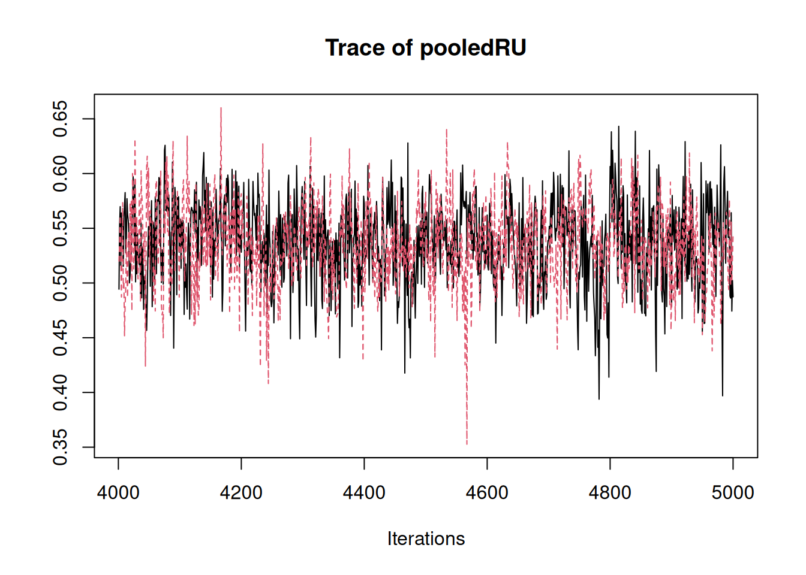

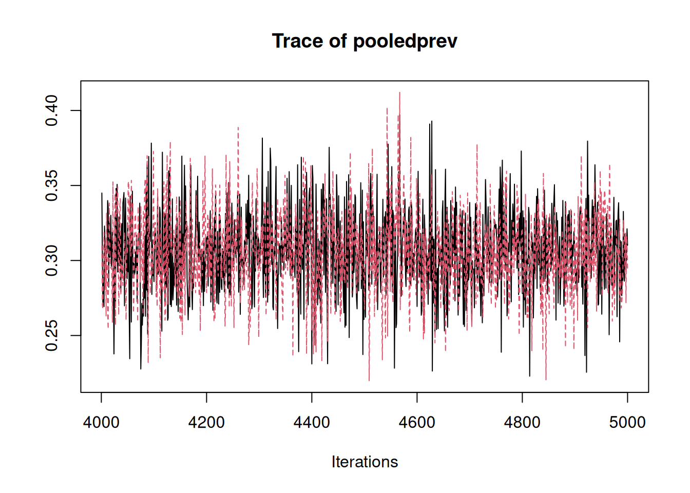


``` output
$NB
$NB$pooled
$NB$pooled$model
     Mean    Median       Low      High
0.2695784 0.2686138 0.2232428 0.3239748

$NB$pooled$treat_all
     Mean    Median       Low      High
0.2276775 0.2266657 0.1750524 0.2872073


$NB$predictive
$NB$predictive$model
      Mean     Median        Low       High
0.28492213 0.26481795 0.05939318 0.63573872

$NB$predictive$treat_all
      Mean     Median        Low       High
 0.2465610  0.2253977 -0.0123709  0.6213438


$NB$pooled_known
$NB$pooled_known$model
     Mean    Median       Low      High
0.4578680 0.4578768 0.4501613 0.4653135

$NB$pooled_known$treat_all
     Mean    Median       Low      High
0.4444444 0.4444444 0.4444444 0.4444444


$NB$pred_known
$NB$pred_known$model
     Mean    Median       Low      High
0.4616724 0.4637329 0.4308031 0.4799763

$NB$pred_known$treat_all
     Mean    Median       Low      High
0.4444444 0.4444444 0.4444444 0.4444444 
```

In the next section, we visualize the per-study and pooled net benefit
estimates using forest plots and interpret the results in the context of
the ADNEX example.

## 6 Forest plots

Similar to the summarizer,
[`plot_forest()`](https://zhipeiwang.github.io/MetaNB/reference/plot_forest.md)
takes posterior samples and the original study-level data as input. The
`metric` argument specifies which quantity to plot (`"NB"`, `"RU"`,
`"sens"`, or `"spec"`), and `label_cols` specifies which columns from
the data should be displayed in the plot table. The function also allows
saving the forest plot as a PNG or PDF file with high resolution by
specifying `file_png` and `file_pdf`.

The `reported_est_col` can be used to supply a column that contains the
reported point estimates of the quantity of interest in the original
studies, which we recommend to include in the plot. When they are not
available, the function will use the input data to either calculate or
take the results from the trivariate meta-analysis. For net benefit,
when reported estimates are not available from primary studies, the
point estimates are calculated from the study-level counts (`TP`, `TN`,
`n_event`, and `n_nonevent`) using the formula prevalence \*
sensitivity - (1 - prevalence) \* (1 - specificity) \* t / (1 - t).
Hence, the threshold `t` must be supplied in case study-level NB values
or confidence intervals need to be calculated from the observed counts.
Similarly, for sensitivity and specificity, when the reported estimates
are not available from primary studies, the function will compute them
from input data. The `reported_low_col` and `reported_high_col` can be
used to specify columns that contain the lower and upper bounds of the
confidence intervals for the reported estimates, which will be used in
the forest plot if supplied. When they are not supplied, the function
will compute the confidence intervals from the input data. For relative
utility, its computation is entirely based on the trivariate model. The
argument `interval_fallback` can be used to specify how to compute the
intervals when they are not reported in the original studies. For all
the metrics (`NB`, `RU`, `sens`, and `spec`), the fallback `model` which
uses the credible intervals from posterior summaries from the trivariate
meta-analysis is available, although we do not recommend this as these
would deviate from the confidence intervals in the original studies due
to borrowing-of-strength and shrinkage towards the pooled estimate. For
net benefit, the fallback `frequentist` can be used, which computes the
confidence intervals using an analytic formula based on the input data,
without borrowing strength across studies ([Sande et al.
2020](#ref-sande_statistical_2020)). For sensitivity and specificity,
the fallback `frequentist` can be used, which computes the confidence
intervals using the Wilson’s method ([Agresti and Coull
1998](#ref-Agresti_1998); [Brown et al. 2001](#ref-brown_2001)) based on
the input data, without borrowing strength across studies. For relative
utility, there’s no frequentist method available, and the only fallback
method is to use the credible intervals from posterior summaries from
the trivariate meta-analysis. The argument `mark_imputed` can be turned
on to indicate which studies have imputed estimates (i.e. those that are
calculated from the input data or estimated using other alternative
methods or estimated using the Bayesian trivariate meta-analysis, rather
than directly reported in the original studies), which will be marked
with a different symbol in the forest plot. During running, messages
will also be printed to indicate which studies have imputed estimates
and which method is used for the point estimates and intervals for those
studies. If `mark_imputed` is turned on, a dagger will be added to the
value imputed for point estimate, and an asterisk will be added to the
interval when the interval is imputed. When `mark_imputed` is turned
off, the imputed estimates will not be marked differently in the forest
plot, but messages will still be printed to indicate which studies have
imputed estimates and which method is used for the point estimates and
intervals for those studies.

For additional arguments that can be used to customize the forest plot,
please refer to the documentation by running
[`?plot_forest`](https://zhipeiwang.github.io/MetaNB/reference/plot_forest.md).

``` r

plot_forest(
  fit_voi$samples,
  data = data_ADNEXCA125 %>%
    mutate(Prev = paste0(round(Prev * 100), "%")),
  tp = TP,
  tn = TN,
  n_event = n_event,
  n_nonevent = n_nonevent,
  label_cols = c("Publication", "Country", "N", "Prev"),
  study_label_col = "Publication",
  metric = "NB",
  t = 0.1,
  xlim = c(-0.1, 0.7),
  mark_imputed = FALSE
)
```

    Using center = 'Mean' (default), so posterior means are displayed as the central estimates in the forest plot. Set center = 'Median' to use posterior median instead.

    All point estimates were replaced by study-level calculated values because reported estimates were unavailable.

    All intervals were replaced by frequentist confidence interval fallback because reported study intervals were unavailable.

    xlab will be deprecated, use set_labs() instead.

    xlim, ticks_at will be deprecated, use set_xaxis() instead.

    theme will be deprecated, use style of forest() instead.

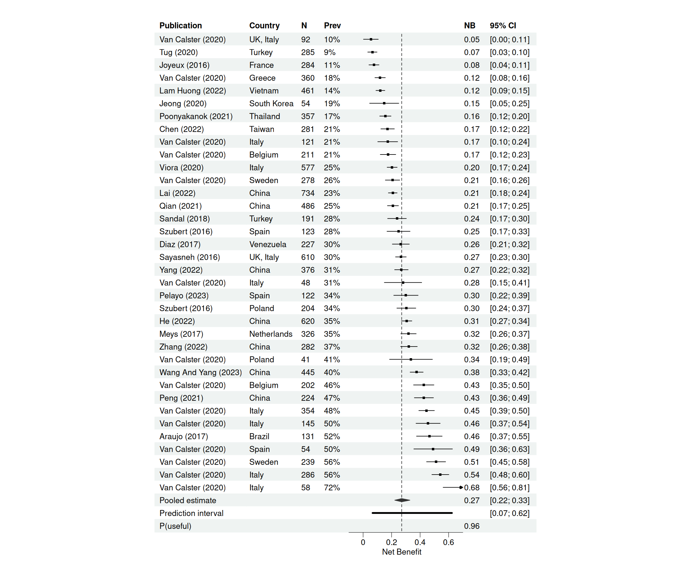

The forest plot shows the net benefit of the model across the 36
external validation studies of ADNEX at a threshold of 0.1. Each square
represents the estimated net benefit in one study. The horizontal line
shows its 95% confidence interval estimated by the aforementioned
method. Note here the `mark_imputed` is turned off because the net
benefit estimates for all the studies are computed from the input data.
We see substantial variation across studies with net benefit ranges from
around 0.05 up to around 0.68. This reflects heterogeneity between
centers.

At the bottom, the diamond represents the pooled net benefit across
studies. The pooled net benefit estimate for the model is 0.27, with a
95% credible interval from 0.22 to 0.33. This means that, using the
model is equivalent to identifying about 27 net true positives per 100
patients without increasing unnecessary interventions. For comparison,
the net benefit of treating all patients is 0.23. So the model improves
net benefit by about 0.04, corresponding to 4 additional net true
positives per 100 patients compared to the treat all strategy. If we
scale this to the European population of around 350000 women assessed
each year, this difference corresponds to roughly 14000 additional
correctly managed cancers per year.

Below that, we see the prediction interval, from 0.07 to 0.62. This
interval reflects the range of net benefit we would expect in a new
center. So although the summary estimate is positive, the performance we
can expect for an unseen setting can vary substantially.

We’ve seen the comparison of the model to treat all which yields a
difference of 0.04 in net benefit. The net benefit of the treat none
strategy is by definition 0. This shows that the model outperforms the
default treat all and treat none strategies.

Finally, we estimate the probability that the model is useful in a new
setting. By useful, we mean that its net benefit exceeds that of the
best alternative strategy at this threshold. For ADNEX at threshold 0.1,
this probability is 0.96. So in 96% of new centers, we expect the model
to provide higher net benefit than the two default strategies.

Forest plots are also available for relative utility (`RU`), sensitivity
(`sens`), and specificity (`spec`), and can be obtained by changing the
`metric` argument in the
[`plot_forest()`](https://zhipeiwang.github.io/MetaNB/reference/plot_forest.md)
function.

## 7 Value-of-information analysis

Value-of-information metrics like Expected Value of Perfect Information
(EVPI) help estimate how much better a decision surrounding prediction
model or biomarker adoption could become if we had more information
before making a choice. We can obtain quantities such as the expected
value of perfect information (EVPI) by setting `compute_EVPI = TRUE`
when fitting the model. This adds the JAGS nodes required for VOI
calculations and returns VOI metrics in the fitted object.

Using the same fitted object for the trivariate meta-analysis summaries
and the VOI metrics is recommended. In JAGS, adding nodes and changing
the set of monitored nodes can change the MCMC draws, even if the model
settings and seed are the same. Therefore, when we plan to report both
the meta-analysis results and VOI quantities, we fit the model once with
`compute_EVPI = TRUE` and use the same posterior samples throughout.

`compute_evppi_prev` can be used to turn on the calculation of expected
value of perfect partial information (EVPPI) for prevalence, which is
set to `TRUE` by default. The argument `center_rows` can be used to
specify which rows (centers) to include in the center-specific EVPI
calculation, which by default is set to `NULL`, and can be turned on by
setting a vector of row numbers corresponding to the centers to include
in the center-specific EVPI calculation. The argument
`center_label_cols` can be used to specify which columns to use for
labeling the centers in the output of center-specific EVPI, which is
only relevant when `center_rows` is not `NULL`. The argument
`auto_resample` can be used to specify whether to automatically draw
additional samples until diagnostics indicate that the estimates of VOI
metrics are stable, which is set to `TRUE` by default. When
`auto_resample` is turned on, the function will check the stability of
the MCMC draws after the initial sampling process, and if the
diagnostics indicate that the estimates are not stable, it will
automatically draw additional samples until they are stable. In this
vignette, we set `auto_resample = FALSE` to keep the runtime short. More
arguments related to the diagnostics and automatic resampling process
can be found in the documentation by running
[`?MA_NB_tri`](https://zhipeiwang.github.io/MetaNB/reference/MA_NB_tri.md).

Here we use the `fit_voi` object created above with the code reiterated
for clarity.

``` r

# fit with VOI enabled

fit_voi <- MA_NB_tri(data = data_ADNEXCA125,
                     tp = TP, tn = TN, n_event = n_event, n_nonevent = n_nonevent,
                     prior_type = "weak",
                     t = 0.1,
                     return_vars = c("NB", "RU", "probuseful", "sens", "spec"),
                     seed = 123,
                     prev_known = 0.5,
                     return_known = TRUE,
                     compute_EVPI = TRUE, # enable the computation of VOI quantities
                     auto_resample = FALSE, # whether to automatically draw additional samples until diagnostics indicate that the EVPI estimates are stable
                     center_rows = 1:36, # which rows (centers) to calculate the center-specific EVPI calculation
                     center_label_cols = c("Publication", "Country") # which columns to use for labeling the centers in the output of center-specific EVPI
                     )
```

### 7.1 Diagnostics and automatic resampling

After fitting the model with VOI enabled, we can check the diagnostics
for the VOI estimates by running `fit_voi$voi_diagnostics`. We are good
if the sigma’s (signal-to-noise ratio for the difference between
competing strategies) are larger than `sigma_min` which by default is
set to 2, and the effective sample size (ESS) is larger than `ess_min`
which by default is set to 400. Here we see all the diagnostics are
good, with the exception that `min_sigma_center_evpi` indicates the
smallest signal-to-noise ratio for the center-specific EVPI estimates is
1, which is smaller than the default threshold of 2, and
`needs_more_sampling = TRUE` also indicates that more sampling is needed
to obtain stable estimates for the center-specific EVPI. This is not
surprising since `stop_reason` correctly indicated that we set
`auto_resample = FALSE` and thus the function did not automatically draw
more samples to obtain stable estimates. If we want to obtain stable
estimates, we can set `auto_resample = TRUE` when fitting the model, but
we have to know that this will likely require a much longer running time
if we want to obtain stable estimates for the center-specific EVPIs for
all the centers, and we can set `max_draws` to control the maximum
number of MCMC draws to be used in the automatic resampling process to
avoid endless running time.

``` r

fit_voi$voi_diagnostics
```

``` output
# A tibble: 1 × 15
  n_draws sigma_strategy sigma_evpi_cluster sigma_evpi_pop sigma_min ess_min
    <int>          <dbl>              <dbl>          <dbl>     <dbl>   <dbl>
1    2000           86.8               5.35            Inf         2     400
  ess_pooledNB ess_pooledNB_TA ess_probuseful min_sigma_center_strategy
         <dbl>           <dbl>          <dbl>                     <dbl>
1        1472.           1497.          1647.                      215.
  min_sigma_center_evpi n_centers_requested needs_more_sampling rounds
                  <dbl>               <int> <lgl>                <dbl>
1                     1                  36 TRUE                     1
  stop_reason
  <chr>
1 auto_resample=FALSE
```

## 8 Population-level and cluster-level EVPI, and EVPPI for prevalence

We can obtain the population-level EVPI, cluster-level EVPI, and EVPPI
for prevalence from the `voi_metrics` element of the fitted object.
`winner_strategy` indicates which strategy has the highest expected net
benefit under current information, based on the posterior predictive
distribution. `NB_currentinfo` is the expected net benefit of this
current optimal strategy, chosen among treat-none, the model, and
treat-all, based on the posterior predictive distribution. The EVPI
quantities are calculated relative to this current decision, so they
represent the expected net benefit gain from resolving uncertainty about
which strategy should be chosen. `NB_cluster_perfectinfo`,
`NB_population_perfectinfo`, and `NB_cluster_partialprev_pi` are the
expected net benefits under cluster-level perfect information
(i.e. infinite sample size per center), population-level perfect
information, and cluster-level partial perfect information for
prevalence (assuming prevalence is known but sensitivity and specificity
are not), respectively.

Interpretation: Population-level EVPI captures the expected NB gain if
our recommendation of the global strategy was made based on perfect
information. It asks the question: if we had complete information, would
we change the overall strategy that we recommend? Here the population
EVPI is 0, which means that even if we had perfect information, we would
not change the overall recommendation to adopt the model.

EVPI at the cluster level captures the expected net benefit gain if we
recommend an optimal strategy for each cluster, if we knew the full
information for each cluster (seen and unseen). It asks a different
question: if each center could choose its own optimal strategy, would
perfect information change those center-specific decisions? The
cluster-level EVPI was 0.000502. When scaled to the European population,
this corresponds to approximately 176 additional true positives, or
about 20 avoided unnecessary interventions given the threshold of 0.1.
So while the global recommendation is stable, there remains some value
in resolving uncertainty at the center level.

But asking every center to know perfect information about sensitivity,
specificity and prevalence is quite demanding. So we can ask a more
practical question. What if we knew the disease prevalence perfectly in
each center? That alone could already help guide decisions. For example,
in a center with very high prevalence, they might be better off treating
all patients. In a center with lower prevalence, they might prefer using
the model instead. The expected value of perfect prevalence information
measures the expected gain from knowing prevalence perfectly, while
sensitivity and specificity remain uncertain. In this case, the EVPPI
was small for the case study, which was 0.000038, corresponding to 13
net true positives when scaled to the EU population.

`diff_modelvsTA` gives the difference in net benefit between the model
and the treat all strategy. `Pooled` gives the difference based on the
posterior distribution and corresponds to the pooled net benefit of the
model minus the pooled net benefit of treat all. `New` gives the
difference based on the predictive distribution and represents the
expected difference in a new setting. They may differ, and the latter is
recommended to be used for implementation decisions ([Ades et al.
2005](#ref-ades_interpretation_2005)). Intervals for both represent the
95% credible and predictive intervals, respectively.

``` r

options(scipen = 999)
as.data.frame(fit_voi$voi_metrics)
```

``` output
  winner_strategy NB_currentinfo NB_cluster_perfectinfo
1           model      0.2846525              0.2851547
  EVPI_cluster_perfectinfo NB_population_perfectinfo
1             0.0005022342                  0.288108
  EVPI_population_perfectinfo NB_cluster_partialprev_pi
1                           0                 0.2846902
  EVPPI_cluster_perfectprevalenceinfo
1                       0.00003770127
                                                                                      diff_modelvsTA
1 Pooled (mean [2.5%, 97.5%]): 0.041 [0.033, 0.049]; New (mean [2.5%, 97.5%]): 0.038 [-0.006, 0.077]
```

### 8.1 Center-specific EVPI

The meta information about the center-specific EVPI calculation can be
found in `fit_voi$voi_center_meta`, which contains the `center_row` and
`center_label_cols` which we supplied when fitting the model, making it
easier to keep track of which centers are included in the
center-specific EVPI calculation and to interpret and report the
results.

``` r

fit_voi$voi_center_meta
```

``` output
   center_row                                      center_label
1           1         Publication=Araujo (2017), Country=Brazil
2           2           Publication=Chen (2022), Country=Taiwan
3           3        Publication=Diaz (2017), Country=Venezuela
4           4              Publication=He (2022), Country=China
5           5     Publication=Jeong (2020), Country=South Korea
6           6         Publication=Joyeux (2016), Country=France
7           7             Publication=Lai (2022), Country=China
8           8     Publication=Lam Huong (2022), Country=Vietnam
9           9            Publication=Peng (2021), Country=China
10         10  Publication=Poonyakanok (2021), Country=Thailand
11         11            Publication=Qian (2021), Country=China
12         12         Publication=Sandal (2018), Country=Turkey
13         13            Publication=Tug (2020), Country=Turkey
14         14           Publication=Viora (2020), Country=Italy
15         15            Publication=Yang (2022), Country=China
16         16           Publication=Zhang (2022), Country=China
17         17          Publication=Pelayo (2023), Country=Spain
18         18   Publication=Wang And Yang (2023), Country=China
19         19        Publication=Szubert (2016), Country=Poland
20         20         Publication=Szubert (2016), Country=Spain
21         21    Publication=Sayasneh (2016), Country=UK, Italy
22         22      Publication=Meys (2017), Country=Netherlands
23         23    Publication=Van Calster (2020), Country=Sweden
24         24     Publication=Van Calster (2020), Country=Italy
25         25    Publication=Van Calster (2020), Country=Greece
26         26   Publication=Van Calster (2020), Country=Belgium
27         27   Publication=Van Calster (2020), Country=Belgium
28         28     Publication=Van Calster (2020), Country=Italy
29         29    Publication=Van Calster (2020), Country=Sweden
30         30     Publication=Van Calster (2020), Country=Italy
31         31     Publication=Van Calster (2020), Country=Italy
32         32    Publication=Van Calster (2020), Country=Poland
33         33     Publication=Van Calster (2020), Country=Spain
34         34     Publication=Van Calster (2020), Country=Italy
35         35     Publication=Van Calster (2020), Country=Italy
36         36 Publication=Van Calster (2020), Country=UK, Italy
```

Similar quantities to what we described for the population-level and
cluster-level EVPI and EVPPI for prevalence are also calculated at the
center level, and can be found in `fit_voi$voi_center_metrics`, where
each row corresponds to a center, and the columns include for example
`NB_model_mean` which is the net benefit of the model for that center,
`NB_TA_mean` which is the net benefit of the treat all strategy for that
center, `NB_center_currentinfo` which is the net benefit of the model
for that center under current information, `NB_center_perfectinfo` which
is the net benefit of the model for that center under perfect
information, and `EVPI_center_perfectinfo` which is the EVPI for that
center.

``` r

fit_voi$voi_center_metrics
```

``` output
# A tibble: 36 × 10
   center_row NB_model_mean NB_TA_mean NB_center_currentinfo
        <int>         <dbl>      <dbl>                 <dbl>
 1          1        0.462     0.453                  0.462
 2          2        0.176     0.124                  0.176
 3          3        0.263     0.220                  0.263
 4          4        0.303     0.273                  0.303
 5          5        0.169     0.116                  0.169
 6          6        0.0863    0.0186                 0.0863
 7          7        0.206     0.147                  0.206
 8          8        0.122     0.0494                 0.122
 9          9        0.420     0.399                  0.420
10         10        0.155     0.0859                 0.155
11         11        0.212     0.165                  0.212
12         12        0.242     0.205                  0.242
13         13        0.0750    0.00258                0.0750
14         14        0.207     0.166                  0.207
15         15        0.270     0.234                  0.270
16         16        0.326     0.302                  0.326
17         17        0.298     0.262                  0.298
18         18        0.367     0.331                  0.367
19         19        0.303     0.269                  0.303
20         20        0.249     0.204                  0.249
21         21        0.265     0.224                  0.265
22         22        0.318     0.285                  0.318
23         23        0.213     0.176                  0.213
24         24        0.443     0.422                  0.443
25         25        0.130     0.0890                 0.130
26         26        0.421     0.397                  0.421
27         27        0.180     0.125                  0.180
28         28        0.530     0.508                  0.530
29         29        0.509     0.502                  0.509
30         30        0.447     0.429                  0.447
31         31        0.174     0.118                  0.174
32         32        0.334     0.312                  0.334
33         33        0.436     0.406                  0.436
34         34        0.272     0.230                  0.272
35         35        0.631     0.629                  0.631
36         36        0.0849    0.0170                 0.0849
   NB_center_perfectinfo EVPI_center_perfectinfo center_winner_strategy
                   <dbl>                   <dbl> <chr>
 1                0.463               0.00106    model
 2                0.176               0          model
 3                0.263               0          model
 4                0.303               0          model
 5                0.169               0.00000873 model
 6                0.0863              0          model
 7                0.206               0          model
 8                0.122               0          model
 9                0.420               0.0000762  model
10                0.155               0          model
11                0.212               0          model
12                0.242               0          model
13                0.0750              0          model
14                0.207               0          model
15                0.270               0          model
16                0.326               0.0000112  model
17                0.298               0.00000151 model
18                0.367               0          model
19                0.303               0          model
20                0.249               0          model
21                0.265               0          model
22                0.318               0          model
23                0.213               0.00000249 model
24                0.443               0.00000378 model
25                0.130               0.00000486 model
26                0.421               0.0000113  model
27                0.180               0          model
28                0.530               0.00000174 model
29                0.510               0.000683   model
30                0.447               0.000152   model
31                0.174               0          model
32                0.335               0.00104    model
33                0.436               0.0000384  model
34                0.272               0.0000117  model
35                0.634               0.00351    model
36                0.0849              0          model
   sigma_center_strategy sigma_center_evpi center_nodes_found
                   <dbl>             <dbl> <lgl>
 1                  491.             12.0  TRUE
 2                  346.            Inf    TRUE
 3                  403.            Inf    TRUE
 4                  736.            Inf    TRUE
 5                  215.              1    TRUE
 6                  522.            Inf    TRUE
 7                  614.            Inf    TRUE
 8                  611.            Inf    TRUE
 9                  580.              4.38 TRUE
10                  612.            Inf    TRUE
11                  499.            Inf    TRUE
12                  337.            Inf    TRUE
13                  568.            Inf    TRUE
14                  528.            Inf    TRUE
15                  489.            Inf    TRUE
16                  500.              2.44 TRUE
17                  324.              1    TRUE
18                  733.            Inf    TRUE
19                  420.            Inf    TRUE
20                  300.            Inf    TRUE
21                  594.            Inf    TRUE
22                  523.            Inf    TRUE
23                  380.              1.09 TRUE
24                  708.              1.42 TRUE
25                  319.              1    TRUE
26                  526.              2.10 TRUE
27                  319.            Inf    TRUE
28                  801.              1.80 TRUE
29                  692.             13.4  TRUE
30                  487.              5.62 TRUE
31                  260.            Inf    TRUE
32                  226.              9.01 TRUE
33                  310.              3.07 TRUE
34                  215.              1.79 TRUE
35                  478.             22.2  TRUE
36                  293.            Inf    TRUE              
```

Here the interpretation of EVPI becomes, for a specific center, how much
would we gain if knew the optimal strategy for that center with
certainty? For example, for row 9, the center-specific EVPI is smaller
than 0.00001, which means that we would gain very little by knowing the
optimal strategy for that center with certainty.

## 9 Fitting with different priors

Finally, we can also fit the model with different priors. For example,
to fit the model with a Wishart prior instead of the default weakly
informative priors, we can set `prior_type = "wishart"` when fitting the
model. When using the Wishart prior, we put the prior on the
variance‐covariance matrix as a whole. This prior is not uninformative
([Wynants et al. 2018](#ref-wynants_random-effects_2018)), and thus is
not recommended. Nevertheless, for interested users,
`prior_type = "wishart"` can be used, with also optional customization
of prior hyperparameters via `wishart_priors`, and the posterior
summaries, forest plots, and VOI metrics can be obtained the same way as
when the weakly realistic priors are used. Users interested in the full
model specification can inspect the JAGS code in `model_text_wishart.R`
in the GitHub repository.

``` r

# fit with VOI enabled

fit_voi_wishart <- MA_NB_tri(data = data_ADNEXCA125,
                     tp = TP, tn = TN, n_event = n_event, n_nonevent = n_nonevent,
                     prior_type = "wishart",
                     t = 0.1,
                     return_vars = c("NB", "RU", "probuseful", "sens", "spec"),
                     seed = 123,
                     prev_known = 0.5,
                     return_known = TRUE,
                     compute_EVPI = TRUE,
                     auto_resample = FALSE,
                     center_rows = 1:36,
                     center_label_cols = c("Publication", "Country")
                     )
```

Ades, A. E., G. Lu, and J. P. T. Higgins. 2005. “The Interpretation of
Random-Effects Meta-Analysis in Decision Models.” *Medical Decision
Making* 25 (6): 646–54. <https://doi.org/10.1177/0272989X05282643>.

Agresti, Alan, and Brent A. Coull. 1998. “Approximate Is Better Than
"Exact" for Interval Estimation of Binomial Proportions.” *The American
Statistician* 52 (2): 119–26. <http://www.jstor.org/stable/2685469>.

Barreñada, Lasai, Ashleigh Ledger, Paula Dhiman, et al. 2024. “ADNEX
Risk Prediction Model for Diagnosis of Ovarian Cancer: Systematic Review
and Meta-Analysis of External Validation Studies.” *BMJ Medicine* 3 (1).
<https://doi.org/10.1136/bmjmed-2023-000817>.

Brown, Lawrence D., T. Tony Cai, and Anirban DasGupta. 2001. “Interval
Estimation for a Binomial Proportion.” *Statistical Science* 16 (2):
101–17. <http://www.jstor.org/stable/2676784>.

Sande, Sumaiya Z., Jialiang Li, Ralph D’Agostino, Tien Yin Wong, and
Ching-Yu Cheng. 2020. “Statistical Inference for Decision Curve
Analysis, with Applications to Cataract Diagnosis.” *Statistics in
Medicine* 39 (22): 2980–3002. <https://doi.org/10.1002/sim.8588>.

Van Calster, Ben, Kirsten Van Hoorde, Lil Valentin, et al. 2014.
*Evaluating the Risk of Ovarian Cancer Before Surgery Using the ADNEX
Model to Differentiate Between Benign, Borderline, Early and Advanced
Stage Invasive, and Secondary Metastatic Tumours: Prospective
Multicentre Diagnostic Study*. October.
<https://doi.org/10.1136/bmj.g5920>.

Wynants, L., R.d. Riley, D. Timmerman, and B. Van Calster. 2018.
“Random-Effects Meta-Analysis of the Clinical Utility of Tests and
Prediction Models.” *Statistics in Medicine* 37 (12): 2034–52.
<https://doi.org/10.1002/sim.7653>.
